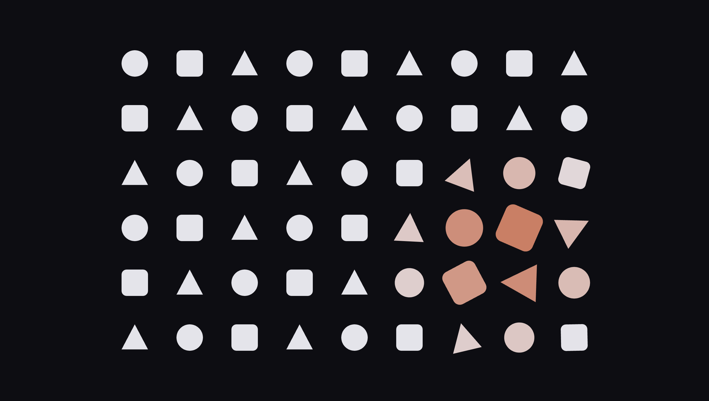

# E0. Forme geometriche reattive

Lavori pubblicati: https://pier-4.github.io/aa2627-tnmi-es/es0/

`preview.png` va creata quando il lavoro è pronto, perché serve all'anteprima nella pagina delle revisioni del corso.
